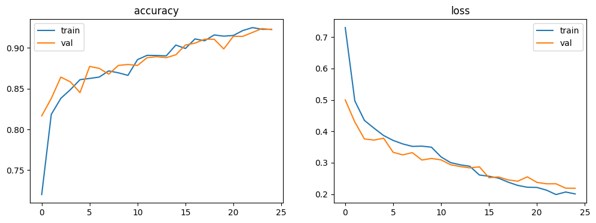

# dl_project
# Brain Tumor MRI Classification

Deep learning model (EfficientNetB0 + Grad-CAM) that classifies MRI scans into glioma, meningioma, pituitary tumor, or no tumor.

**Dataset:** [Brain Tumor MRI Dataset (Kaggle)](https://www.kaggle.com/datasets/masoudnickparvar/brain-tumor-mri-dataset)

## Results
Test accuracy:  0.8656

## How to run
Open the notebook in Google Colab, set the runtime to GPU, and run all cells.
