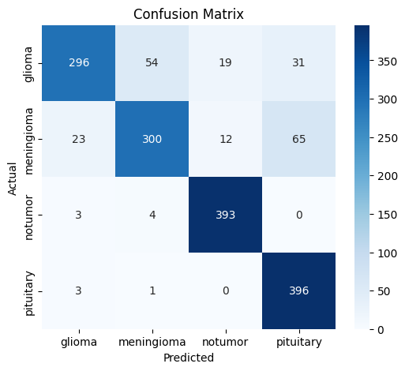
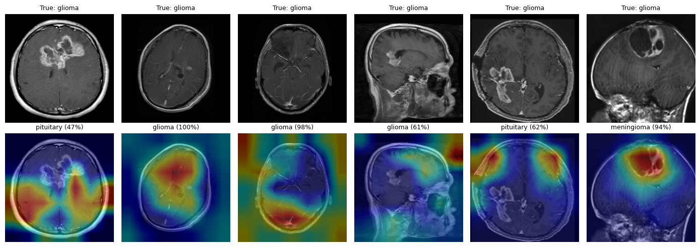

# dl_project
# Brain Tumor MRI Classification

Deep learning model (EfficientNetB0 + Grad-CAM) that classifies MRI scans into glioma, meningioma, pituitary tumor, or no tumor.

**Dataset:** [Brain Tumor MRI Dataset (Kaggle)](https://www.kaggle.com/datasets/masoudnickparvar/brain-tumor-mri-dataset)

## Results
Test accuracy:  0.8656
 precision    recall  f1-score   support

      glioma     0.9108    0.7400    0.8166       400
  meningioma     0.8357    0.7500    0.7905       400
     notumor     0.9269    0.9825    0.9539       400
   pituitary     0.8049    0.9900    0.8879       400

    accuracy                         0.8656      1600
   macro avg     0.8695    0.8656    0.8622      1600
weighted avg     0.8695    0.8656    0.8622      1600

